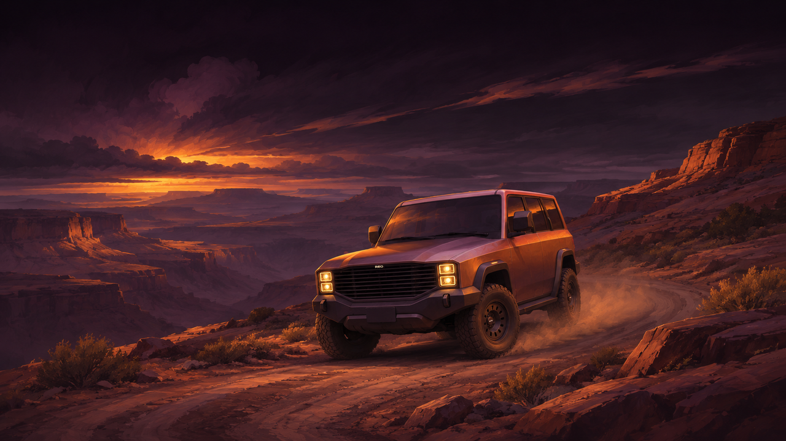

# Ember Drive

A dark Omarchy theme with plum shadows, burnt-orange accents, warm ivory text, and an orange-to-rose active window border.



## Install

Once this folder is in a public GitHub repo, substitute its owner and name in the install command.

```sh
omarchy theme install https://github.com/jeffmtb/omarchy-ember-drive-theme
```

Omarchy reads `colors.toml` and generates the terminal, shell, and app palettes. The explicit ANSI keys are also available to theme galleries.

## Wallpapers

- **Canyon Sunset** and **Alpine Afterglow** were made with ImageGen using REO design references.
- **REO Studio** and **REO at Dusk** use artwork from Frank Stephenson Design. [REO project gallery](https://www.frankstephenson.com/projects/reo/)
